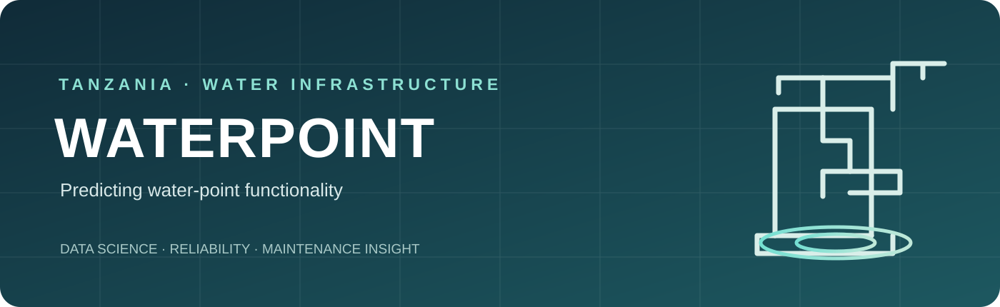
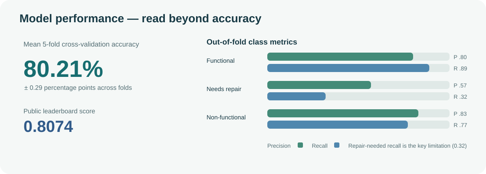
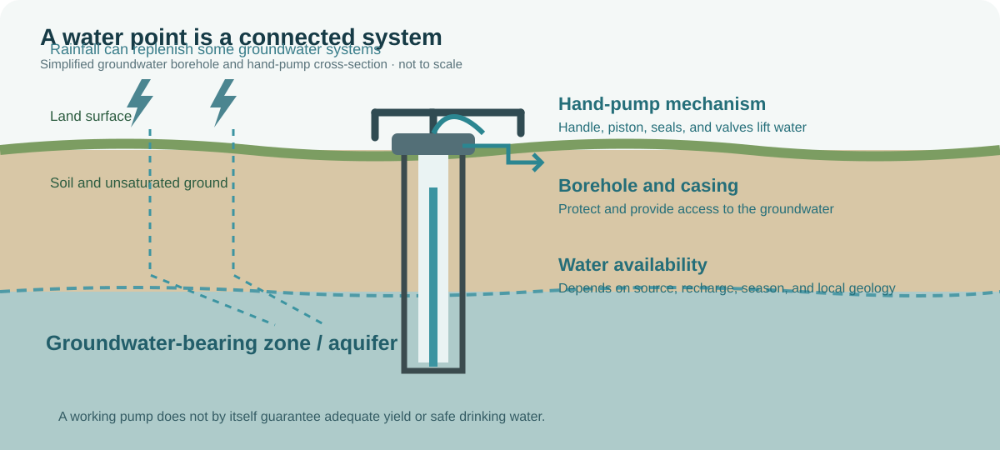
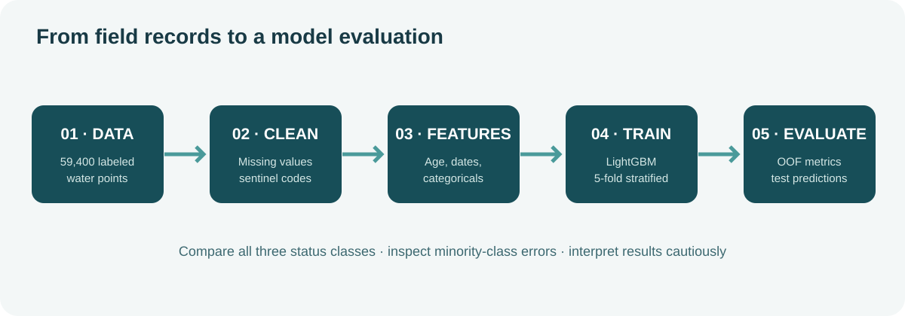
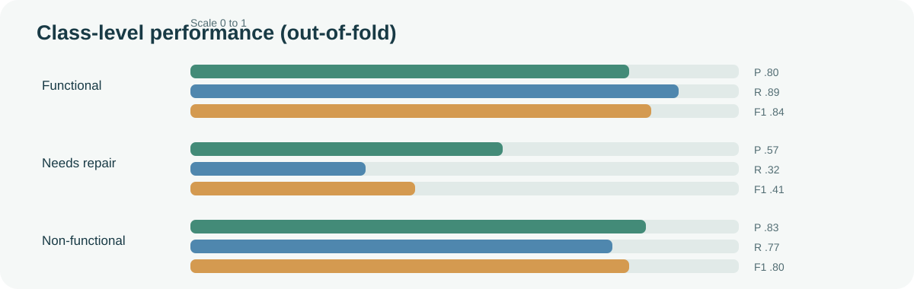
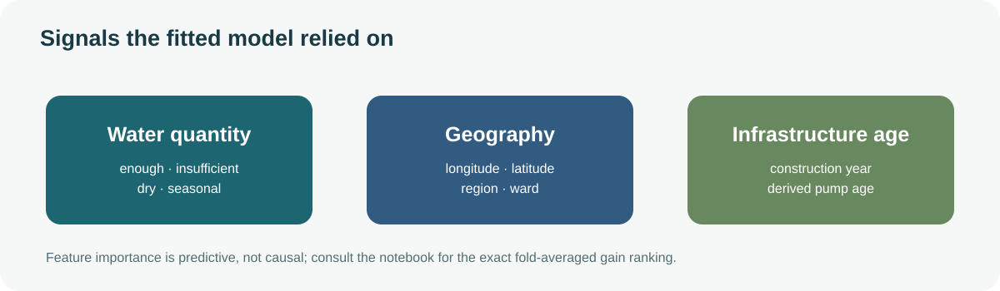

# WATERPOINT — Tanzania Water Pump Status Prediction

<p align="center">
  
</p>

<p align="center">
  <strong>Water access · Infrastructure reliability · Predictive maintenance · Multiclass machine learning</strong>
</p>

<p align="center">
  
  
  
  
</p>

**WATERPOINT** explores whether machine learning can help identify water points in Tanzania that are functional, need repair, or are non-functional. The project uses the DrivenData competition **[Pump it Up: Data Mining the Water Table](https://www.drivendata.org/competitions/7/)**, with records sourced from Taarifa and the Tanzanian Ministry of Water.

A water point is more than a pump: it is part of a local water-supply system. Its reliability depends on the water source, pump and delivery hardware, construction, maintenance arrangements, available water, and the people and institutions responsible for keeping it working. The notebook combines these kinds of records with geographic and installation information to train a LightGBM multiclass classifier.

**Open the complete notebook:** [pump_prediction_notebook.ipynb](pump_prediction_notebook.ipynb)

> **Scope:** This is a retrospective classification experiment on historical competition data. It is not a live monitoring system, a field inspection, a groundwater assessment, or a guarantee that a predicted pump will remain operational. Model predictions should support—not replace—local verification and maintenance decisions.

## Results at a glance


| Measure | Result |
|---|---:|
| Training water points | **59,400** |
| Test water points | **14,850** |
| Input attributes | **40** |
| Final model | **LightGBM multiclass** |
| Cross-validation | **5-fold stratified** |
| Mean CV accuracy | **80.21% ± 0.29 percentage points** |
| Public leaderboard score | **0.8074** |

The reported fold accuracies were 80.68%, 80.40%, 79.93%, 80.05%, and 79.99%. The notebook's public leaderboard score was 0.8074. These are the recorded results of this experiment, not a claim of field-tested operational accuracy.

<p align="center">
  
</p>

## 1. Why water-point reliability matters

Access to safe water depends not only on installing infrastructure, but also on keeping it functional over time. When a community water point fails, households may need to travel farther, rely on less reliable sources, or wait for repairs. Maintenance teams and local authorities have finite time, transport, spare parts, and budgets. Better information about where problems are likely to occur could help them plan inspections and prioritize follow-up.

The central research question is:

**Can recorded characteristics of a water point help predict whether it is functional, needs repair, or is non-functional?**

This is a predictive-maintenance framing. The model does not determine why a pump failed, prove that a particular maintenance arrangement caused failure, or decide which community should receive resources. It estimates patterns in historical records that could be investigated by people responsible for water services.

## 2. Understanding the water system

<p align="center">
  
</p>

### Groundwater, aquifers, and boreholes

Many rural water points draw water from **groundwater**: water stored below the land surface in pores and fractures in soil and rock. An **aquifer** is a geological formation that can store and transmit usable quantities of groundwater. Rainfall and surface water can replenish some aquifers, but recharge rates vary with geology, climate, land use, and local conditions.

A **borehole** is a drilled, relatively narrow access point into the subsurface. It may be fitted with a casing and a pump to lift water to the surface. A hand pump uses human power; a motorized pump uses an engine or electric motor. Other water points may use springs, gravity-fed systems, or different extraction arrangements.

A working pump does not automatically mean that a water point provides a reliable supply. Water availability, source condition, pump condition, pipes, storage, distribution hardware, and management all matter.

### How a hand pump lifts water

A common hand-pump mechanism uses a piston and valves inside a cylinder. Moving the handle drives the piston. On the lift stroke, a valve arrangement allows water to move upward through the pump column; on the return stroke, water is drawn into the cylinder for the next cycle. The exact design varies by pump type and installation.

The pump is only one part of the system. A damaged seal, worn piston, failed valve, corroded pipe, blocked intake, or broken handle can interrupt delivery even when groundwater is present. Conversely, a pump can be mechanically intact while the source is dry or yields too little water.

### Water availability is not identical to mechanical functionality

The competition's `quantity` field records water availability using categories such as `enough`, `insufficient`, `dry`, and `seasonal`. This is important context, but it is not a laboratory measurement of aquifer capacity or a direct mechanical test of the pump.

The notebook found that `quantity` was the strongest model feature by average gain importance. That is a predictive association in these records. It should not be interpreted as proof that water quantity alone caused a pump's recorded status.

## 3. What do the three target classes mean?

The competition asks the model to classify each water point into one of three recorded status groups:


| Target label | Practical interpretation |
|---|---|
| **functional** | Recorded as working |
| **functional needs repair** | Still functioning, but recorded as needing repair |
| **non functional** | Recorded as not working |

The middle class is operationally important: a pump that still works but needs attention may deteriorate into a complete outage if maintenance is delayed. It is also the rarest class in the training data, which makes it difficult for a model to identify reliably.

These are dataset labels, not a universal engineering standard or a current inspection result. A field team should verify the actual condition, source yield, water quality, and repair needs.

## 4. Dataset and class balance

The competition data is provided in three files:

| File | Records | Columns |
|---|---:|---:|
| `train_features.csv` | 59,400 | 40 |
| `train_labels.csv` | 59,400 | 2 |
| `test_features.csv` | 14,850 | 40 |

The training features are joined to their labels using the water-point identifier. The test records have no labels in the competition data and are used to generate the submission.

### Training target distribution

| Status | Water points | Share |
|---|---:|---:|
| Functional | 32,259 | 54.31% |
| Non-functional | 22,824 | 38.42% |
| Functional needs repair | 4,317 | 7.27% |

<Chart content={{"chartType":"bar","meta":{"description":"Distribution of the 59,400 labeled training water points."},"xKey":"status","series":[{"dataKey":"count","label":"Water points","valueFormat":"compact"}],"data":[{"status":"Functional","count":32259},{"status":"Non-functional","count":22824},{"status":"Needs repair","count":4317}]}}/>

A classifier that always predicts the majority class would achieve approximately **54.31% accuracy** on this training distribution. The model's 80.21% cross-validated accuracy is substantially higher, but overall accuracy alone does not tell the whole story: the rare repair-needed class is much harder to identify.

## 5. Exploratory analysis: what signals appear in the records?

The notebook examines several patterns before modeling:

- **Geography:** water-point status varies across the recorded locations. Latitude, longitude, region, basin, district, and ward provide spatial context.
- **Pump age:** older recorded infrastructure skews more toward non-functional status. Construction year is used to derive an approximate age relative to the record date.
- **Water quantity:** records marked dry are much more frequently non-functional than records marked as having enough water.
- **Missingness:** several fields contain missing values, and some zero values are placeholders rather than genuine measurements.

The exploratory charts are in the notebook. Geographic clustering and age patterns are useful for hypothesis generation, but they do not establish the causes of failure. Differences may also reflect reporting practices, infrastructure mix, local conditions, and other unmeasured factors.

## 6. Data cleaning and feature engineering

The notebook handles several dataset quirks explicitly.

**Missing and sentinel values**
- Missing categorical values are assigned a dedicated `missing` category.
- Zero longitude is treated as an unknown-coordinate sentinel rather than a real location.
- Latitude values above -0.1 are treated as invalid for the Tanzania records and set to missing.
- Zero construction year is converted to missing.
- A flag records missing GPS elevation and another records missing coordinates.

**Derived time features**
- `pump_age`: recorded year minus construction year.
- `year_recorded` and `month_recorded`: extracted from the observation date.

**Dropped fields**
- `id`: identifier, not a substantive predictor.
- `date_recorded`: replaced by parsed year and month.
- `recorded_by`: constant in this dataset.
- `wpt_name`: free-text water-point name.
- `num_private`: largely uninformative in this experiment.

**Categorical variables**
- Categorical values are converted to strings, with missing values represented explicitly.
- Label encoding is applied consistently across combined train and test feature tables.
- The resulting categorical columns are supplied to LightGBM as categorical features.

The model uses the cleaned feature set, including geography, water availability, management, payment, source, extraction type, water-point type, and construction information.

## 7. Modeling approach

<p align="center">
  
</p>

The selected model is **LightGBM**, a gradient-boosted decision-tree framework suited to mixed numerical and categorical tabular data.

Key settings recorded in the notebook include:
- Multiclass objective with three output classes
- Learning rate: 0.05
- Maximum leaf count: 63
- Feature fraction: 0.8
- Bagging fraction: 0.8
- Five-fold stratified cross-validation
- Early stopping after 50 rounds without validation improvement
- Random seed: 42

Stratification keeps class proportions approximately consistent across folds. Each fold trains on four-fifths of the labeled data and evaluates on the remaining fifth. The final test probabilities are averaged across the five fitted fold models before choosing the highest-probability class.

## 8. Model evaluation: overall accuracy and the minority-class gap

The five fold accuracies were:

| Fold | Accuracy |
|---|---:|
| 1 | 80.68% |
| 2 | 80.40% |
| 3 | 79.93% |
| 4 | 80.05% |
| 5 | 79.99% |
| **Mean ± standard deviation** | **80.21% ± 0.29 pp** |

The out-of-fold classification report is more revealing:

| Status | Precision | Recall | F1-score | Support |
|---|---:|---:|---:|---:|
| Functional | 0.80 | 0.89 | 0.84 | 32,259 |
| Functional needs repair | 0.57 | 0.32 | 0.41 | 4,317 |
| Non-functional | 0.83 | 0.77 | 0.80 | 22,824 |
| **Macro average** | **0.74** | **0.66** | **0.68** | **59,400** |
| **Weighted average** | **0.80** | **0.80** | **0.79** | **59,400** |

<p align="center">
  
</p>

**The main weakness is the repair-needed class.** Its recall is 0.32: the model identifies only about one in three labeled repair-needed cases in out-of-fold evaluation. Many are classified as either functional or non-functional. This matters operationally because missing an early repair signal could delay maintenance.

A strong overall accuracy score must therefore not be mistaken for equally strong performance on all three classes. A maintenance deployment would need a deliberate evaluation of missed failures, false alarms, inspection capacity, and the relative cost of each error.

## 9. Feature importance

The notebook averages LightGBM gain-based feature importance across the five fitted folds. The most influential signals include:

- `quantity`
- Geographic information such as longitude, latitude, region code, and ward
- Construction year and derived pump age

<p align="center">
  
</p>

Gain importance measures how much a feature contributes to split improvements in the fitted trees. It is not a causal explanation, and correlated variables can share or redistribute importance. The notebook's feature-importance chart provides the detailed model-derived ranking.

## 10. Submission output

The notebook generates `submission.csv` with two columns:

- `id`: the test water-point identifier
- `status_group`: one of the three predicted classes

The test prediction distribution was approximately:

| Predicted status | Share |
|---|---:|
| Functional | 60.69% |
| Non-functional | 35.49% |
| Functional needs repair | 3.82% |

The model predicts the repair-needed class less often than it appears in the labeled training set (7.27%). This reflects its conservative behavior on the minority class and reinforces the need for class-specific evaluation before any operational use.

## 11. Limitations and responsible use

1. **Historical records:** the competition data reflects observations collected in an earlier period. It does not represent current pump condition.
2. **Minority-class recall:** repair-needed recall is only 0.32 in the reported out-of-fold evaluation. A missed repair can matter more than the overall accuracy suggests.
3. **No causal inference:** feature importance and geographic patterns do not establish why a water point failed.
4. **No live sensing:** the model does not receive current flow, pressure, water-level, electrical, or telemetry measurements.
5. **No water-quality assessment:** a functional pump does not guarantee microbiologically or chemically safe water.
6. **Validation design:** stratified random folds estimate performance on held-out records from the same dataset, but may not measure transfer to a new district, future year, or different reporting system.
7. **Decision support only:** predictions should be checked by local water technicians and authorities. They must not be used to deny communities access, deprioritize vulnerable areas, or replace field inspections.

A stronger operational study would use time-stamped maintenance histories, repeat observations, independently verified failure events, spatially or temporally separated validation, and a cost-sensitive metric that reflects the consequences of missing a pump that needs repair.

## 12. Next research directions

The notebook identifies several practical ways to extend the experiment:

- Improve high-cardinality encoding for installer, funder, and ward fields using leakage-safe target or frequency encoding.
- Test class weighting and a two-stage classifier to improve repair-needed recall.
- Engineer spatial context such as nearby water-point density, while validating carefully to avoid geographic leakage.
- Compare LightGBM with Random Forest and XGBoost, then evaluate probability ensembling.
- Tune model parameters systematically with Optuna.
- Add longitudinal service and maintenance records so the task can move from static status classification toward actual failure-risk forecasting.

The most valuable next step is not simply a higher headline accuracy. It is a model that more reliably identifies water points needing intervention, while making the trade-off between missed repairs and unnecessary visits explicit.

## Reproducibility

The notebook was executed in Google Colab and uses Python, pandas, NumPy, Matplotlib, scikit-learn, and LightGBM. It expects these three competition CSV files in the working directory:

```text
train_features.csv
train_labels.csv
test_features.csv
```

Download the files from the official [DrivenData competition page](https://www.drivendata.org/competitions/7/), subject to the competition's access and data-use terms, then run the notebook cells in order. The notebook creates `submission.csv` in the working directory.

## Repository structure

```text
.
├── README.md
├── pump_prediction_notebook.ipynb
└── assets/
    ├── waterpoint-banner.svg
    ├── water-system.svg
    ├── workflow.svg
    ├── model-results.svg
    ├── class-performance.svg
    └── feature-importance.svg
```

## References and data provenance

- [DrivenData — Pump it Up: Data Mining the Water Table](https://www.drivendata.org/competitions/7/) — competition description, task, and data access.
- [Taarifa](https://taarifa.org/) — civic technology and reporting context associated with the water-point data.
- [WHO/UNICEF Joint Monitoring Programme (JMP)](https://washdata.org/) — international monitoring of drinking-water, sanitation, and hygiene services.
- [UNICEF — Water, sanitation and hygiene](https://www.unicef.org/wash) — background on water access and WASH services.

The project is a machine-learning analysis of the competition dataset. It does not constitute an official assessment by the Tanzanian Ministry of Water, Taarifa, UNICEF, WHO, or DrivenData.

---

<p align="center">
  <sub>WATERPOINT · Turning historical infrastructure data into a careful starting point for maintenance insight</sub>
</p>
